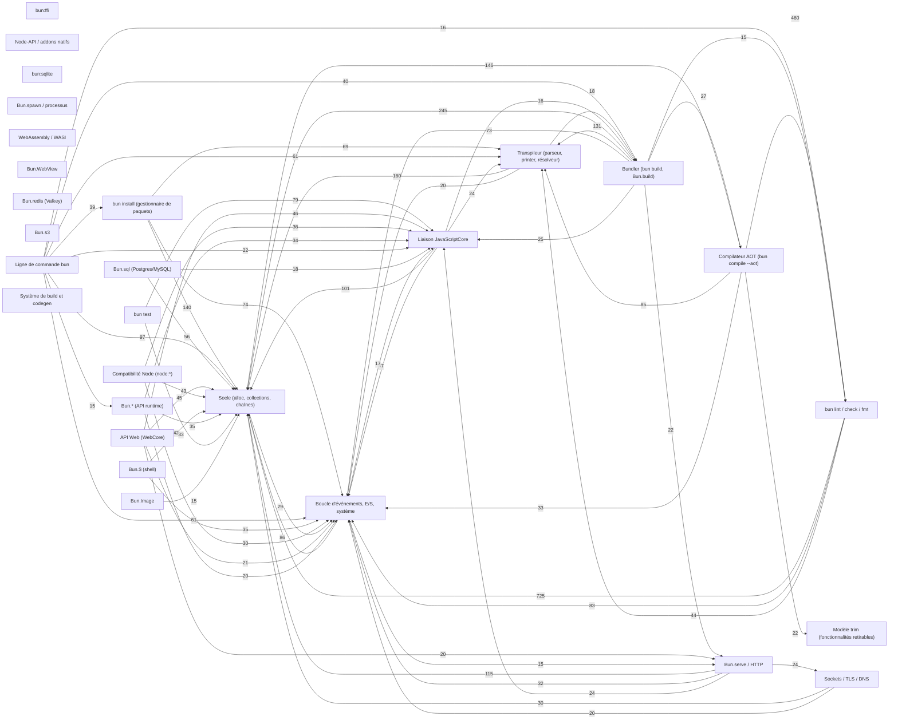

# Graphe des fonctionnalités de bun (amont)

Généré par `sdk/tools/bun-graph.ts` le 2026-11-12 depuis bun 1.4.4 @ `4b8463ee11cb` (2026-11-12T17:58:46+01:00). Ne pas éditer : `bun sdk/tools/bun-graph.ts <racine-bun>`. Données complètes : [feature-graph.json](feature-graph.json).

## Comptes

| Nœuds | n | | Arêtes | n |
|---|---|---|---|---|
| api | 424 | | calls-native | 159 |
| binding | 150 | | contains | 462 |
| build | 86 | | declares | 21 |
| cpp | 27 | | depends | 1204 |
| crate | 136 | | dev-depends | 17 |
| domain | 29 | | exposes | 298 |
| feature | 267 | | fetch-depends | 5 |
| module | 219 | | implemented-in | 152 |
| native | 37 | | implements | 68 |
| trim-feature | 73 | | imports | 1084 |
| vendor | 23 | | in | 37 |
|  |  | | includes | 127 |
|  |  | | links | 16 |
|  |  | | member-of | 154 |
|  |  | | part-of | 23 |
|  |  | | references | 750 |
|  |  | | uses | 1457 |

Sources : modèle trim `src/trim/features/*.def` (fonctionnalités, trim-features) ; `src/codegen/builtins/host/features-*.builtins.ts` (built-in -> fonctionnalité) ; `Cargo.toml` (crates, dépendances `path`) ; `scripts/build/deps/*.ts` (vendeurs, `fetchDeps`) ; `src/jsc/bindings/BunObject.cpp` (`bunObjectTable`) ; `packages/bun-types/*.d.ts` ; `src/js/**` (modules, `require`, `$bindgen`/`$newCppFunction`) ; `*.bind.ts` (bindgen) ; C/C++ par répertoire ; imports relatifs de `scripts/build` et `src/codegen`.

## Domaines

| Domaine | Chemins | LOC | Crates | API exposées (extrait) | Fonctionnalités trim |
|---|---|---|---|---|---|
| **Bun.* (API runtime)** (`bun-apis`) | `src/jsc/bindings/BunObject*`, `src/runtime/api` | 47105 (rs 44166, ts 1603, cpp 1284) | bun_jsc (hôte), bun_runtime (hôte) | Bun.$, Bun.Archive, Bun.ArrayBufferSink, Bun.CSRF, Bun.Cookie, Bun.CookieMap, Bun.CryptoHasher, Bun.FFI … (+138) | BunInfo, BunUtilities |
| **bun:ffi** (`ffi`) | `packages/bun-types/ffi.d.ts`, `src/js/ahead-of-time/bun/ffi.ts`, `src/js/bun/ffi.ts`, `src/jsc/FFI.rs` … (+5) | 8105 (rs 4378, ts 1855, h 703) | bun_tcc_sys, bun_jsc (hôte), bun_runtime (hôte) | %FFI%, %FFICallback%, Bun.FFI, bun:ffi | Ffi |
| **Node-API / addons natifs** (`napi`) | `src/jsc/bindings/Napi*`, `src/jsc/bindings/napi*`, `src/jsc/bindings/v8`, `src/runtime/napi` | 21179 (cpp 8289, rs 7196, h 5689) | bun_jsc (hôte), bun_runtime (hôte) | process.dlopen | NativeAddons |
| **bun:sqlite** (`sqlite`) | `packages/bun-types/sqlite.d.ts`, `src/js/bun/sqlite.ts`, `src/jsc/bindings/sqlite` | 295558 (c 269669, h 17023, cpp 6473; dont 269669 vendu) | bun_jsc (hôte) | node:sqlite, bun:sqlite | Sqlite, SqliteExtensions |
| **Bun.sql (Postgres/MySQL)** (`sql`) | `packages/bun-types/sql.d.ts`, `src/js/bun/sql.ts`, `src/sql`, `src/sql_jsc` | 20817 (rs 17783, ts 2979, toml 55) | bun_sql, bun_sql_jsc | Bun.SQL, Bun.sql, bun:sql | Sql |
| **Bun.serve / HTTP** (`serve`) | `packages/bun-types/serve.d.ts`, `src/http`, `src/http_jsc`, `src/http_types` … (+4) | 68604 (rs 64202, cpp 2184, ts 1915) | bun_http, bun_http_jsc, bun_http_types, bun_picohttp, bun_uws, bun_uws_sys … (+1) | Bun.serve, fetch, fetch.preconnect | Fetch, Http3, HttpClient, Serve, ServeHttp2 |
| **Sockets / TLS / DNS** (`sockets`) | `src/boringssl`, `src/boringssl_sys`, `src/cares_sys`, `src/dns` … (+2) | 23429 (rs 22800, ts 543, toml 86) | bun_boringssl, bun_boringssl_sys, bun_cares_sys, bun_dns, bun_lsquic_sys, bun_runtime (hôte) | Bun.connect, Bun.dns, Bun.dns.getCacheStats, Bun.dns.getServers, Bun.dns.lookup, Bun.dns.lookupService, Bun.dns.prefetch, Bun.dns.resolve … (+14) | Dns, Sockets, Tls, TlsSockets, Udp |
| **Bun.$ (shell)** (`shell`) | `packages/bun-types/shell.d.ts`, `src/runtime/shell`, `src/shell_parser` | 27290 (rs 26832, ts 438, toml 20) | bun_shell_parser, bun_runtime (hôte) | Bun.$ | Shell |
| **Bun.spawn / processus** (`spawn`) | `src/spawn`, `src/spawn_sys` | 6747 (rs 6695, toml 52) | bun_spawn, bun_spawn_sys | Bun.spawn, Bun.spawnSync, node:child_process | BunSpawn, BunSpawnSync, ChildProcess, Spawn, Terminal |
| **bun test** (`test-runner`) | `packages/bun-types/test.d.ts`, `src/runtime/test_runner` | 34943 (rs 30533, ts 4410) | bun_runtime (hôte) | bun:test, node:test | Test, TestCommand |
| **bun install (gestionnaire de paquets)** (`install`) | `src/archive`, `src/install`, `src/install_jsc`, `src/install_types` … (+5) | 121375 (rs 120830, toml 293, ts 252) | bun_archive, bun_install, bun_install_jsc, bun_install_types, bun_patch, bun_patch_jsc … (+4) | Bun.Archive, Bun.semver | Archive, Install, Semver |
| **Bundler (bun build, Bun.build)** (`bundler`) | `packages/bun-types/bundle.d.ts`, `packages/bun-types/devserver.d.ts`, `src/bundler`, `src/bundler_jsc` … (+8) | 170811 (rs 161980, ts 5821, tsx 1257) | bun_bundler, bun_bundler_jsc, bun_css, bun_css_jsc, bun_router, bun_sourcemap … (+3) | Bun.build, bun:bundle | BuildCommand, Bundler, CssParser, ReactCompiler, SourceMaps |
| **Transpileur (parseur, printer, résolveur)** (`transpiler`) | `src/ast`, `src/ast_jsc`, `src/js_parser`, `src/js_parser_jsc` … (+6) | 183463 (rs 182362, ts 696, toml 290) | bun_ast, bun_ast_jsc, bun_js_parser, bun_js_parser_jsc, bun_js_printer, bun_parsers … (+4) | Bun.Transpiler | DataFileLoaders, RuntimeTranspiler |
| **bun lint / check / fmt** (`lint-check-fmt`) | `src/format`, `src/lint`, `src/sema` | 843117 (rs 836918, js 3341, mjs 1943) | bun_format, bun_format_conformance, bun_lint, bun_lint_conformance, bun_lint_driver, bun_lint_eslint … (+15) |  | Check, Fmt, Lint |
| **Compilateur AOT (bun compile --aot)** (`aot`) | `src/aot`, `src/exe_format`, `src/executable` | 297972 (rs 295774, ts 2013, toml 185) | bun_aot, bun_aot_absent, bun_aot_builtins, bun_aot_interface, bun_exe_format, bun_executable |  | AotCompiler, ImageCompiler |
| **Compatibilité Node (node:*)** (`node-compat`) | `src/js/node`, `src/jsc/bindings/node`, `src/node_path`, `src/runtime/node` | 127166 (ts 52930, rs 43691, cpp 14970) | bun_node_path, bun_jsc (hôte), bun_runtime (hôte) | node:buffer, node:buffer.resolveObjectURL, node:constants, node:module.SourceMap, node:module._load, node:module.findSourceMap, node:sqlite, node:string_decoder … (+66) | NodeCrypto, NodeFs, NodeHttp, NodeOs, NodePath, NodeUtil, NodeVm |
| **API Web (WebCore)** (`web-apis`) | `src/js/builtins`, `src/jsc/bindings/webcore`, `src/jsc/bindings/webcrypto`, `src/runtime/webcore` | 152597 (cpp 75171, rs 43313, h 27830) | bun_jsc (hôte), bun_runtime (hôte) | ReadableStream, Request, Request.prototype.body, Request.prototype.formData, Request.prototype.headers, Request.prototype.signal, Request.prototype.textStream, Response … (+6) | Bodies, Headers, TextDecoder, TextEncoder, Url, WebCrypto, WebSocket, WebStreams, Worker |
| **WebAssembly / WASI** (`wasm`) | `packages/bun-types/wasm.d.ts`, `src/js/builtins/WasmStreaming.ts`, `src/js/wasi-runner.js`, `src/jsc/bindings/webcore/JSWasmStreamingCompiler.*` … (+1) | 725 (cpp 225, ts 209, rs 181) | bun_jsc (hôte), bun_runtime (hôte) | WebAssembly.compileStreaming, WebAssembly.instantiateStreaming, node:wasi | WebAssembly |
| **Bun.WebView** (`webview`) | `src/runtime/webview` | 9533 (cpp 5956, h 2134, rs 1443) | bun_runtime (hôte) | Bun.WebView | WebView |
| **Bun.redis (Valkey)** (`valkey`) | `packages/bun-types/redis.d.ts`, `src/runtime/valkey_jsc`, `src/valkey` | 11059 (rs 6787, ts 4257, toml 15) | bun_valkey, bun_runtime (hôte) | Bun.RedisClient, Bun.redis | Valkey |
| **Bun.s3** (`s3`) | `packages/bun-types/s3.d.ts`, `src/s3_signing` | 3131 (rs 1621, ts 1488, toml 22) | bun_s3_signing | Bun.S3Client, Bun.s3 | S3Client, S3Responses |
| **Bun.Image** (`image`) | `src/png`, `src/runtime/image` | 7899 (rs 7814, ts 68, toml 17) | bun_png, bun_runtime (hôte) | Bun.Image | Image |
| **Liaison JavaScriptCore** (`engine`) | `src/jsc`, `src/jsc_macros`, `src/yarr` | 655922 (c 282855, cpp 230360, h 82265; dont 269669 vendu) | bun_jsc, bun_jsc_macros, bun_yarr | bun:jsc.codeCoverageForFile, bun:jsc.deserialize, bun:jsc.generateHeapSnapshotForDebugging, bun:jsc.profile, bun:jsc.samplingProfilerStackTraces, bun:jsc.serialize, bun:jsc.startRemoteDebugger, bun:jsc.startSamplingProfiler … (+1) | BunJsc |
| **Boucle d'événements, E/S, système** (`event-loop-io`) | `src/event_loop`, `src/io`, `src/libuv_sys`, `src/platform` … (+6) | 50134 (rs 49734, toml 201, cpp 118) | bun_event_loop, bun_io, bun_libuv_sys, bun_platform, bun_sys, bun_sys_jsc … (+4) |  |  |
| **Ligne de commande bun** (`cli`) | `src/bunfig`, `src/clap`, `src/clap_macros`, `src/runtime/cli` | 80949 (rs 79668, tsx 783, ts 314) | bun_bunfig, bun_clap, bun_clap_macros, bun_runtime (hôte) |  | Bunfig, Create, Repl, Tools, Upgrade |
| **Socle (alloc, collections, chaînes)** (`core`) | `src/bun_alloc`, `src/bun_core`, `src/bun_core_macros`, `src/collections` … (+9) | 66469 (rs 66052, toml 254, cpp 163) | bun_alloc, bun_collections, bun_core, bun_core_macros, bun_errno, bun_highway … (+7) |  |  |
| **Modèle trim (fonctionnalités retirables)** (`trim`) | `src/trim` | 13447 (rs 12419, def 985, toml 43) | bun_removable_features, bun_trim |  |  |
| **Système de build et codegen** (`build-system`) | `Cargo.toml`, `package.json`, `scripts/build`, `src/codegen` | 76036 (ts 73549, mjs 1661, c 826) |  |  |  |
| **WebGPU** (`webgpu`) | — | 0 | — | — | voir ci-dessous |

WebGPU : recherche de `/webgpu|navigator\.gpu|GPUAdapter|GPUDevice|wgpu|dawn/i` dans src/, scripts/build et packages/bun-types (.rs .cpp .h .c .mm .ts .js) : 2 fichier(s).
- `scripts/build/deps/webkit.ts:450: ["ENABLE_WEBGPU", 0],`
- `scripts/build/deps/webkit.ts:451: ["ENABLE_WEBGPU_SWIFT", 0],`
- `src/lint/linter/globals/tables.rs:130: GM_xmlhttpRequestGPUGPUAdapterGPUAdapterInfoGPUAddressModeGPUAutoLayoutModeGPUBi`
- `src/lint/linter/globals/tables.rs:140: GPUDepthStencilStateGPUDeviceGPUDeviceDescriptorGPUDeviceEventMapGPUDeviceLostIn`
- `src/lint/linter/globals/tables.rs:158: GPUTextureViewGPUTextureViewDescriptorGPUTextureViewDimensionGPUUncapturedErrorE`

## Dépendances entre domaines

Poids = nombre de fichiers Rust du domaine source qui nomment une crate (`bun_x::`) ou un module (`crate::m`) du domaine cible, plus les dépendances Cargo entre crates. Les 60 plus fortes :

## Interop native (bun:ffi, Node-API)

- **Ffi** — bun:ffi and its C compiler (src/trim/features/bun.def:13) ; trim-features : ffi, native-code ; utilisé par : %FFI%, %FFICallback%, Bun.FFI, src/runtime/ffi/FFIObject.bind.ts, src/runtime/ffi/ffi.bind.ts, bun:ffi
- **NativeAddons** — native addons, process.dlopen and N-API (src/trim/features/bun.def:115) ; trim-features : native-addons, native-code ; utilisé par : Bun.FFI, process.dlopen, src/runtime/ffi/ffi.bind.ts
- `src/runtime/ffi/ffi.bind.ts` : FFI, callback, cc, cfunction, closeCallback, dlopen, linkLibrary, linkSymbols, makeCallback, makeFunction, openLibrary, printSource, viewSource ; symboles C : Bun__FFI__callback, Bun__FFI__cfunction, Bun__FFI__closeCallback, Bun__FFI__dlopen, Bun__FFI__linkSymbols, Bun__FFI__viewSource
- `src/runtime/ffi/FFIObject.bind.ts` : toArrayBuffer, toBuffer ; symboles C : Bun__FFIObject__toArrayBuffer, Bun__FFIObject__toBuffer
- `src/runtime/napi/napi_body.bind.ts` : threadsafeFunctionLiveCount
- `bun:ffi` : CFunction, CString, FFIType, JSCallback, cc, dlopen, linkSymbols, native, ptr, read, suffix, toArrayBuffer, toBuffer, viewSource
- Fonctionnalités tirées par les API FFI : BigInt64Array, BigUint64Array, Buffer, DataView, Ffi, Float16Array, Float32Array, Float64Array, Int16Array, Int32Array, Int8Array, NativeAddons, Uint16Array, Uint32Array, Uint8ClampedArray

## Trim-features (src/trim/features/trim-features.def)

| Trim-feature | Fonctionnalités | Économie Linux / macOS (Mo) | Description |
|---|---|---|---|
| `aot` | AotCompiler, ImageCompiler | 9.6 / 9.3 | The ahead-of-time compiler: `bun compile`, `bun build --compile --aot`, `bun run --aot` and `compile.aot` in `Bun.build()`. Included in `"cli"`. An executabl… |
| `archive` | Archive | 0 / 0 | `Bun.Archive`, and everything else that reads or writes a tar archive. |
| `brotli` | BrotliDecoder, BrotliEncoder | 0.4 / 0.3 | Brotli in `node:zlib`, `CompressionStream`, `DecompressionStream` and `fetch`. Without it, `fetch` doesn't offer `br` in `Accept-Encoding`. |
| `bun-jsc` | BunJsc | 0 / 0 | `bun:jsc` and `node:v8`. |
| `bundler` | BuildCommand, Bundler, CssParser, InternalForTesting, ReactCompiler | 6 / 2.5 | `bun build`, `Bun.build()`, HTML imports and the development server in `Bun.serve()`, with the CSS parser and the React Compiler. `Bun.Transpiler` doesn't ne… |
| `check` | Check | 0.3 / 0.3 | `bun check`, `--check`, and type checking and declaration files in `bun build` and `Bun.build()`. Included in `"cli"`. It shares the type checker with `"lint… |
| `cli` | AotCompiler, BuildCommand, Check, Create, Fmt, ImageCompiler, Install, Lint, Repl, TestCommand, Tools, Upgrade | 47.4 / 44.8 | The whole `bun` command line: the package manager, the test runner, `bun build`, `bun lint`, `bun fmt`, `bun check` and the ahead-of-time compiler. Includes … |
| `color` | Color | 0 / 0 | `Bun.color()`. |
| `cookie` | Cookie | 0 / 0 | `Bun.Cookie`, `Bun.CookieMap` and `request.cookies` in `Bun.serve()`. |
| `create` | Create | 0 / 0 | `bun create` and `bun init`. Included in `"cli"`. |
| `cron` | Cron | 0 / 0 | `Bun.cron()`. Included in `"spawn"`. |
| `crypto-hasher` | CryptoHasher | 0 / 0 | `Bun.CryptoHasher`. |
| `csrf` | Csrf | 0 / 0 | `Bun.CSRF`. |
| `dialogs` | Dialogs | 0 / 0 | `alert()`, `confirm()` and `prompt()`, which read from the terminal. |
| `dns` | Dns | 0.3 / 0.3 | `Bun.dns` and `node:dns`. Without it, `fetch()`, `Bun.connect()` and `node:net` still resolve host names, but `node:net` doesn't emit `lookup` and `node:dgra… |
| `fetch` | Fetch, HttpClient | 0.3 / 0 | Bun's HTTP client: `fetch()`, `Bun.fetch()` and `Bun.FetchSession`. `Request`, `Response` and `Headers` don't need it. Neither does `http.request()` in `node… |
| `ffi` | Ffi | 0.7 / 0.5 | `bun:ffi` and its C compiler. Included in `"native-code"`. |
| `fmt` | Fmt | 0.2 / 0 | `bun fmt`. Included in `"cli"`. It shares about 8 MB of code with `"lint"`, so keeping either one keeps that code. |
| `fs-router` | FileSystemRouter | 0 / 0 | `Bun.FileSystemRouter`. |
| `glob` | Glob | 0 / 0 | `Bun.Glob`. |
| `hash` | Hash, Hashers | 0 / 0 | `Bun.hash()`, `Bun.sha()` and the hash classes from `Bun.MD4` to `Bun.SHA512_256`. `Bun.CryptoHasher` has its own name, `"crypto-hasher"`. |
| `html-rewriter` | HtmlRewriter | 0 / 0 | `HTMLRewriter`. |
| `http2` | NodeHttp2, ServeHttp2 | 0.3 / 0 | `node:http2`, and HTTP/2 and HTTP/3 in `Bun.serve()`. |
| `http3` | Http3, NodeQuic | 0.5 / 0 | HTTP/3 in `Bun.serve()`, and `node:quic`. |
| `image` | Image | 1.3 / 0.9 | `Bun.Image` and `.image()` on a `Blob`. |
| `inspector` | Inspector | 0.6 / 0.7 | The debugger: `--inspect`, `BUN_INSPECT` and `node:inspector`. An executable built with `aot` also needs `compile.inspector` before a debugger can attach. |
| `install` | Install | 1.8 / 1.6 | The package manager: `bun install`, `add`, `remove`, `update`, `link`, `unlink`, `pm` and its subcommands, `patch`, `outdated`, `publish`, `audit`, `why`, `p… |
| `interpreter` | BuiltinSourceText, DataFileLoaders, Interpreter, RuntimeTranspiler | 3.7 / 2.7 | Everything that runs code that isn't in the executable: the JavaScript parser, the interpreter and the transpiler. `eval()`, `new Function()`, `import()` and… |
| `intl` | IntlCollation, IntlDateTimeFormat, IntlDisplayNames, IntlLocale, IntlNumberFormat, IntlOther, IntlPluralRules, IntlSegmenter, IntlUnits | 10.5 / 0 | All of `Intl`, plus `localeCompare()`, `toLocaleString()`, `toLocaleDateString()` and `toLocaleTimeString()`, with their locale data. Includes `"intl-segment… |
| `intl-segmenter` | IntlSegmenter | 3.1 / 0 | `Intl.Segmenter` and its dictionaries. Included in `"intl"`. On macOS, the dictionaries come with the system. |
| `ipc` | Ipc, ProcessIpc | 0 / 0 | IPC with the parent process that started the executable with `ipc` or `fork()`: `process.send()`, `process.disconnect()`, `process.channel`, `process.connect… |
| `jit` | JIT | 14.1 / 14.2 | The JIT compilers for JavaScript, regular expressions and WebAssembly. An executable built with `aot` never starts them, so `trim` removes them. Without `aot… |
| `json5` | Json5 | 0 / 0 | `Bun.JSON5`. Importing a `.json5` file doesn't need it. |
| `jsonc` | Jsonc | 0 / 0 | `Bun.JSONC`. Importing a `.jsonc` file doesn't need it. |
| `jsonl` | Jsonl | 0 / 0 | `Bun.JSONL`. |
| `lint` | Lint | 12.2 / 11.9 | `bun lint`. Included in `"cli"`. |
| `markdown` | Markdown | 0 / 0 | `Bun.markdown`. Importing a `.md` file doesn't need it. |
| `native-addons` | NativeAddons | 0 / 0 | Native addons: `.node` files, `process.dlopen()`, N-API, and the V8 and libuv symbols that addons link against. Included in `"native-code"`. |
| `native-code` | Ffi, NativeAddons, SqliteExtensions | 0.7 / 0.5 | Everything that loads native code: `bun:ffi`, `process.dlopen()`, `.node` addons, and `Database.loadExtension()` in `bun:sqlite`. Includes `"ffi"` and `"nati… |
| `node-crypto` | NodeCrypto | 0.4 / 0 | `node:crypto`. |
| `node-vm` | NodeVm | 0.1 / 0 | `node:vm`. |
| `password` | Password | 0 / 0 | `Bun.password`. |
| `plugin` | Plugin | 0 / 0 | `Bun.plugin()`. |
| `process-kill` | ProcessKill | 0 / 0 | `process.kill()`. Without it, the executable can't send a signal to any process, including itself. |
| `process-report` | ProcessReport | 0 / 0 | `process.report`, the Node.js diagnostic report. It lists environment variables, loaded libraries and network interfaces. |
| `profiler` | Profilers | 0.3 / 0.4 | The CPU and heap profilers, heap snapshots and code coverage: `--cpu-prof`, `--heap-prof`, `Bun.generateHeapSnapshot()`, `v8.writeHeapSnapshot()` and the pro… |
| `redis` | Valkey | 0.3 / 0.3 | `Bun.redis`, `Bun.RedisClient` and `--redis-preconnect`. |
| `repl` | Repl | 0 / 0 | `bun repl`. Included in `"cli"`. |
| `run` | Tools | 0.6 / 0.3 | The rest of the command line: `bun run` with `package.json` scripts and `--filter`, `bun exec`, `--help` and shell completions. Included in `"cli"`. The exec… |
| `s3` | S3Client, S3Responses | 0.1 / 0 | `Bun.s3`, `Bun.S3Client`, and `s3:` URLs in `Bun.file()`, `Bun.write()` and `fetch()`. Without it, an `s3:` URL throws an `Error` whose `code` is `"ERR_FEATU… |
| `secrets` | Secrets | 0 / 0 | `Bun.secrets`. |
| `semver` | Semver | 0 / 0 | `Bun.semver`. |
| `serve` | BunInfo, Serve | 0.4 / 0.3 | `Bun.serve()`, and the `node:http` and `node:https` servers, which are built on it. Without it, their `listen()` emits an `"error"` event. `fetch()`, `http.r… |
| `shell` | Shell | 0.4 / 0.4 | `Bun.$`, the shell. Included in `"spawn"`. |
| `sockets` | Sockets | 0 / 0 | `Bun.listen()` and `Bun.connect()`, and everything that opens or accepts a connection through `node:net`: `net.connect()`, `net.createServer().listen()`, `no… |
| `source-maps` | SourceMaps | 0 / 0 | Source maps: the ones that the `sourcemap` option embeds in the executable, which stack traces use, and `SourceMap` and `findSourceMap()` in `node:module`. |
| `spawn` | BunSpawn, BunSpawnSync, ChildProcess, CrashReport, Cron, HotReload, InternalForTesting, NodeCluster, OpenInEditor, ProcessExecve, Shell, Spawn, Terminal, WebView | 1.8 / 1.3 | Everything that starts a process: `Bun.spawn()`, `Bun.spawnSync()`, `node:child_process`, `node:cluster`, `Bun.$`, `Bun.cron`, `Bun.WebView`, `Bun.Terminal`,… |
| `sql` | Sql | 0.3 / 0.3 | `Bun.sql` and `Bun.SQL` for PostgreSQL and MySQL. |
| `sqlite` | Sqlite, SqliteExtensions | 1.9 / 0 | `bun:sqlite`, `node:sqlite` and imports with `type: "sqlite"`. On macOS, Bun loads the system's SQLite, so this is only the bindings and the loader. |
| `temporal` | Temporal | 0.5 / 0.5 | `Temporal` and `Date.prototype.toTemporalInstant()`. |
| `terminal` | Terminal | 0 / 0 | `Bun.Terminal` and the `terminal` option of `Bun.spawn()`. Included in `"spawn"`. |
| `test` | InternalForTesting, Test, TestCommand | 2.1 / 1.8 | `bun test`, `bun:test` and `node:test`: the test runner, `expect()` and its matchers, mocks and snapshots. |
| `toml` | Toml | 0 / 0 | `Bun.TOML`. Importing a `.toml` file doesn't need it. |
| `udp` | Udp | 0 / 0 | `Bun.udpSocket()` and `node:dgram`. |
| `upgrade` | Upgrade | 0 / 0 | `bun upgrade`. Included in `"cli"`. |
| `url-pattern` | UrlPattern | 0 / 0 | `URLPattern`. |
| `web-crypto` | WebCrypto | 0.2 / 0 | `crypto.subtle`, `SubtleCrypto` and `CryptoKey`. `crypto.getRandomValues()` and `crypto.randomUUID()` don't need it. |
| `webassembly` | WebAssembly | 1 / 1.1 | `WebAssembly`, `node:wasi` and imports of `.wasm` files. |
| `websocket` | WebSocket | 0.2 / 0 | The `WebSocket` client. WebSockets in `Bun.serve()` don't need it. |
| `webview` | WebView | 0 / 0 | `Bun.WebView`. Included in `"spawn"`. |
| `worker` | Worker, WorkerConstructor | 0 / 0 | `Worker` and `node:worker_threads`. |
| `xml` | Xml | 0 / 0 | `Bun.XML`. Importing an `.xml` file doesn't need it. |
| `yaml` | Yaml | 0 / 0 | `Bun.YAML`. Importing a `.yaml` file doesn't need it. |

## Propriétés de l'objet Bun (src/jsc/bindings/BunObject.cpp)

| Propriété | Symbole C++ | Typée (bun-types) | Fonctionnalités (built-ins) |
|---|---|---|---|
| `Bun.$` | `constructBunShell` | oui | Buffer, ChildProcess, Shell |
| `Bun.Archive` | `Bun::Bindgen::Generated::Archive::getArchiveConstructor` | oui | Archive, Bodies, Buffer, LibdeflateCompressor |
| `Bun.ArrayBufferSink` | `Bun::Bindgen::Generated::Sink::getArrayBufferSinkConstructor` | oui | WebStreams |
| `Bun.CSRF` | `Bun::Bindgen::Generated::CsrfJsc::createCSRF` | oui | Csrf |
| `Bun.Cookie` | `constructCookieObject` | oui | Cookie |
| `Bun.CookieMap` | `constructCookieMapObject` | oui | Cookie |
| `Bun.CryptoHasher` | `Bun::Bindgen::Generated::CryptoHasher::getCryptoHasherConstructor` | oui | Buffer, CryptoHasher |
| `Bun.FFI` | `BunObject_lazyPropCb_wrap_FFI` | non | BigInt64Array, BigUint64Array, Buffer, DataView, Ffi, Float16Array, Float32Array, Float64Array, Int16Array, Int32Array, Int8Array, NativeAddons, Uint16Array, Uint32Array, Uint8ClampedArray |
| `Bun.FetchSession` | `Bun::Bindgen::Generated::FetchSession::getFetchSessionConstructor` | oui | Bodies, BrotliDecoder, BrotliEncoder, Fetch, Headers, Http3, HttpClient, LibdeflateCompressor, S3Client, S3Responses, Tls, TlsSockets, WebStreams, X509, ZstdCompressor |
| `Bun.FileSystemRouter` | `Bun::Bindgen::Generated::FilesystemRouter::getFileSystemRouterConstructor` | oui | Buffer, FileSystemRouter, RegExp, RuntimeTranspiler |
| `Bun.Glob` | `Bun::Bindgen::Generated::Glob::getGlobConstructor` | oui | Glob |
| `Bun.Image` | `Bun::Bindgen::Generated::Image::getImageConstructor` | oui | Bodies, BrotliDecoder, Buffer, HttpClient, Image, S3Client, S3Responses, Tls, TlsSockets, WebStreams, X509 |
| `Bun.JSON5` | `Bun::Bindgen::Generated::JSON5Object::createJSON5` | oui | Json5 |
| `Bun.JSONC` | `Bun::Bindgen::Generated::JSONCObject::createJSONC` | oui | Jsonc |
| `Bun.JSONL` | `constructJSONLObject` | oui | Jsonl |
| `Bun.MD4` | `Bun::Bindgen::Generated::CryptoHasher::getMD4Constructor` | oui | Buffer, Hashers |
| `Bun.MD5` | `Bun::Bindgen::Generated::CryptoHasher::getMD5Constructor` | oui | Buffer, Hashers |
| `Bun.ModuleGraph` | `constructModuleGraphObject` | oui | ModuleGraph |
| `Bun.RedisClient` | `Bun::Bindgen::Generated::Valkey::getRedisClientConstructor` | oui | Buffer, FileSink, Tls, TlsSockets, Valkey, X509 |
| `Bun.S3Client` | `Bun::Bindgen::Generated::S3Client::getS3ClientConstructor` | oui | Bodies, BrotliDecoder, Buffer, HttpClient, S3Client, S3Responses, Tls, TlsSockets, WebStreams, X509 |
| `Bun.SHA1` | `Bun::Bindgen::Generated::CryptoHasher::getSHA1Constructor` | oui | Buffer, Hashers |
| `Bun.SHA224` | `Bun::Bindgen::Generated::CryptoHasher::getSHA224Constructor` | oui | Buffer, Hashers |
| `Bun.SHA256` | `Bun::Bindgen::Generated::CryptoHasher::getSHA256Constructor` | oui | Buffer, Hashers |
| `Bun.SHA384` | `Bun::Bindgen::Generated::CryptoHasher::getSHA384Constructor` | oui | Buffer, Hashers |
| `Bun.SHA512` | `Bun::Bindgen::Generated::CryptoHasher::getSHA512Constructor` | oui | Buffer, Hashers |
| `Bun.SHA512_256` | `Bun::Bindgen::Generated::CryptoHasher::getSHA512_256Constructor` | oui | Buffer, Hashers |
| `Bun.SQL` | `constructBunSQLObject` | oui | Sql |
| `Bun.TOML` | `Bun::Bindgen::Generated::TOMLObject::createTOML` | oui | Temporal, Toml |
| `Bun.Terminal` | `Bun::Bindgen::Generated::Terminal::getTerminalConstructor` | oui | Buffer, Terminal |
| `Bun.Transpiler` | `Bun::Bindgen::Generated::Transpiler::getTranspilerConstructor` | oui | Buffer, BuiltinSourceText, Interpreter, PackageFiles, RegExp, RegExpUnicodeProperties, RuntimeTranspiler |
| `Bun.WebView` | `constructWebViewObject` | oui | Bodies, Buffer, ChildProcess, Events, HttpClient, Tls, TlsSockets, WebSocket, WebView, X509 |
| `Bun.XML` | `Bun::Bindgen::Generated::XMLObject::createXML` | oui | Xml |
| `Bun.YAML` | `Bun::Bindgen::Generated::YAMLObject::createYAML` | oui | Yaml |
| `Bun.allocUnsafe` | `Bun::Bindgen::Generated::BunObject::jsAllocUnsafe` | oui | BunUtilities |
| `Bun.argv` | `BunObject_lazyPropCb_wrap_argv` | oui |  |
| `Bun.build` | `Bun::Bindgen::Generated::JSBundler::jsBuild` | oui | AotCompiler, Bodies, Buffer, BuiltinSourceText, Bundler, Check, ChildProcess, CssParser, HotReload, HttpClient, ImageCompiler, Inspector, Interpreter, JIT, PackageFiles, ReactCompiler, RegExp, RegExpUnicodeProperties, RuntimeTranspiler, Temporal, WebStreams, ZstdCompressor |
| `Bun.color` | `Bun::Bindgen::Generated::ColorJs::jsColor` | oui | Color |
| `Bun.concatArrayBuffers` | `functionConcatTypedArrays` | oui | BunUtilities |
| `Bun.connect` | `Bun::Bindgen::Generated::Listener::jsConnect` | oui | Buffer, Sockets, Tls, TlsSockets, X509 |
| `Bun.cron` | `BunObject_lazyPropCb_wrap_cron` | oui | ChildProcess, Cron |
| `Bun.cwd` | `BunObject_lazyPropCb_wrap_cwd` | non |  |
| `Bun.deepEquals` | `functionBunDeepEquals` | oui | Buffer, DeepEquals |
| `Bun.deepMatch` | `functionBunDeepMatch` | oui | Buffer, DeepEquals |
| `Bun.deflateSync` | `Bun::Bindgen::Generated::BunObject::jsDeflateSync` | oui | Buffer, BunDeflate, CompressionFunctions, LibdeflateCompressor |
| `Bun.dns` | `constructDNSObject` | oui | Dns |
| `Bun.embeddedFiles` | `BunObject_lazyPropCb_wrap_embeddedFiles` | oui | Bodies |
| `Bun.enableANSIColors` | `BunObject_lazyPropCb_wrap_enableANSIColors` | oui |  |
| `Bun.env` | `constructEnvObject` | oui |  |
| `Bun.escapeHTML` | `jsFunctionBunEscapeHTML` | oui | EscapeHtml |
| `Bun.fetch` | `constructBunFetchObject` | oui | Bodies, BrotliDecoder, BrotliEncoder, Fetch, Headers, Http3, HttpClient, LibdeflateCompressor, S3Client, S3Responses, Tls, TlsSockets, WebStreams, X509, ZstdCompressor |
| `Bun.file` | `Bun::Bindgen::Generated::Blob::jsFile` | oui | Bodies, HttpClient |
| `Bun.fileURLToPath` | `functionFileURLToPath` | oui |  |
| `Bun.gc` | `Bun::Bindgen::Generated::BunObject::jsGc` | oui | BunUtilities |
| `Bun.generateHeapSnapshot` | `functionGenerateHeapSnapshot` | oui | Profilers |
| `Bun.gunzipSync` | `Bun::Bindgen::Generated::BunObject::jsGunzipSync` | oui | Buffer, CompressionFunctions |
| `Bun.gzipSync` | `Bun::Bindgen::Generated::BunObject::jsGzipSync` | oui | Buffer, BunDeflate, CompressionFunctions, LibdeflateCompressor |
| `Bun.hash` | `Bun::Bindgen::Generated::HashObject::createHash` | oui | Hash |
| `Bun.indexOfLine` | `Bun::Bindgen::Generated::BunObject::jsIndexOfLine` | oui | BunUtilities |
| `Bun.inflateSync` | `Bun::Bindgen::Generated::BunObject::jsInflateSync` | oui | Buffer, CompressionFunctions |
| `Bun.inspect` | `BunObject_lazyPropCb_wrap_inspect` | oui | ConsoleTable, StringWidth |
| `Bun.isMainThread` | `constructIsMainThread` | oui |  |
| `Bun.isStandaloneExecutable` | `BunObject_lazyPropCb_wrap_isStandaloneExecutable` | oui |  |
| `Bun.jest` | `Bun::Bindgen::Generated::Jest::jsJest` | non | Buffer, DeepEquals, RegExp, RuntimeTranspiler, Test |
| `Bun.listen` | `Bun::Bindgen::Generated::Listener::jsListen` | oui | Buffer, Sockets, Tls, TlsSockets, X509 |
| `Bun.main` | `bunObjectMain` | oui |  |
| `Bun.markdown` | `Bun::Bindgen::Generated::MarkdownObject::createMarkdown` | oui | Markdown, StringHTML |
| `Bun.mmap` | `Bun::Bindgen::Generated::BunObject::jsMmap` | oui | BunUtilities |
| `Bun.nanoseconds` | `functionBunNanoseconds` | oui | BunUtilities |
| `Bun.openInEditor` | `Bun::Bindgen::Generated::BunObject::jsOpenInEditor` | oui | ChildProcess, OpenInEditor |
| `Bun.origin` | `BunObject_lazyPropCb_wrap_origin` | non |  |
| `Bun.password` | `Bun::Bindgen::Generated::PasswordObject::createPassword` | oui | Password |
| `Bun.pathToFileURL` | `functionPathToFileURL` | oui | Url |
| `Bun.peek` | `constructBunPeekObject` | oui | BunUtilities |
| `Bun.plugin` | `constructPluginObject` | oui | Buffer, Plugin, RegExp, RuntimeTranspiler |
| `Bun.postgres` | `defaultBunSQLObject` | oui |  |
| `Bun.randomUUIDv5` | `Bun::Bindgen::Generated::Crypto::jsRandomUUIDv5` | oui | Buffer, Uuid |
| `Bun.randomUUIDv7` | `Bun::Bindgen::Generated::Crypto::jsRandomUUIDv7` | oui | Buffer, Uuid |
| `Bun.readableStreamToArray` | `WebCore::jsFunctionReadableStreamToArray` | oui | WebStreams |
| `Bun.readableStreamToArrayBuffer` | `WebCore::jsFunctionReadableStreamToArrayBuffer` | oui | WebStreams |
| `Bun.readableStreamToBlob` | `WebCore::jsFunctionReadableStreamToBlob` | oui | Bodies, WebStreams |
| `Bun.readableStreamToBytes` | `WebCore::jsFunctionReadableStreamToBytes` | oui | WebStreams |
| `Bun.readableStreamToFormData` | `WebCore::jsFunctionReadableStreamToFormData` | oui | Bodies, FormData, WebStreams |
| `Bun.readableStreamToJSON` | `WebCore::jsFunctionReadableStreamToJSON` | oui | WebStreams |
| `Bun.readableStreamToText` | `WebCore::jsFunctionReadableStreamToText` | oui | WebStreams |
| `Bun.redis` | `BunObject_lazyPropCb_wrap_valkey` | oui | Buffer, FileSink, Tls, TlsSockets, Valkey, X509 |
| `Bun.registerMacro` | `Bun::Bindgen::Generated::BunObjectInternals::jsRegisterMacro` | non | Buffer, BuiltinSourceText, Interpreter, PackageFiles, RegExp, RegExpUnicodeProperties, RuntimeTranspiler |
| `Bun.resolve` | `Bun::Bindgen::Generated::BunObject::jsResolve` | oui |  |
| `Bun.resolveSync` | `Bun::Bindgen::Generated::BunObject::jsResolveSync` | oui |  |
| `Bun.revision` | `constructBunRevision` | oui |  |
| `Bun.s3` | `BunObject_lazyPropCb_wrap_s3` | oui | Bodies, BrotliDecoder, Buffer, HttpClient, S3Client, S3Responses, Tls, TlsSockets, WebStreams, X509 |
| `Bun.secrets` | `constructSecretsObject` | oui | Secrets |
| `Bun.semver` | `Bun::Bindgen::Generated::SemverObject::createSemver` | oui | Semver |
| `Bun.serve` | `Bun::Bindgen::Generated::BunObject::jsServe` | oui | AbortSignal, Bodies, Buffer, BuiltinSourceText, BunInfo, Bundler, ChildProcess, Cookie, CssParser, Events, Headers, Http3, HttpClient, Inspector, Interpreter, NodeHttp, ReactCompiler, RegExp, RegExpUnicodeProperties, RuntimeTranspiler, Serve, ServeHttp2, Temporal, Tls, TlsSockets, Url, WebStreams, ZstdCompressor |
| `Bun.sha` | `Bun::Bindgen::Generated::CryptoHasher::jsSha` | oui | Buffer, Hashers |
| `Bun.shrink` | `Bun::Bindgen::Generated::BunObject::jsShrink` | oui | BunUtilities |
| `Bun.sleep` | `functionBunSleep` | oui | BunUtilities |
| `Bun.sleepSync` | `Bun::Bindgen::Generated::BunObject::jsSleepSync` | oui | BunUtilities |
| `Bun.sliceAnsi` | `jsFunctionBunSliceAnsi` | oui | Ansi, StringWidth |
| `Bun.spawn` | `Bun::Bindgen::Generated::JsBunSpawnBindings::jsSpawn` | oui | BigInt64Array, BigUint64Array, Bodies, BrotliDecoder, Buffer, BunSpawn, ChildProcess, DataView, ExternalSerializedValues, Float16Array, Float32Array, Float64Array, HttpClient, Int16Array, Int32Array, Int8Array, Ipc, NetAddresses, RegExpUnicodeProperties, S3Client, S3Responses, Spawn, StructuredClone, Terminal, Tls, TlsSockets, Uint16Array, Uint32Array, Uint8ClampedArray, WebCrypto, WebStreams, X509 |
| `Bun.spawnSync` | `Bun::Bindgen::Generated::JsBunSpawnBindings::jsSpawnSync` | oui | Buffer, BunSpawnSync, ChildProcess, Spawn, Terminal |
| `Bun.sql` | `defaultBunSQLObject` | oui | Sql |
| `Bun.stderr` | `BunObject_lazyPropCb_wrap_stderr` | oui | Bodies, FileSink, WebStreams |
| `Bun.stdin` | `BunObject_lazyPropCb_wrap_stdin` | oui | Bodies, FileSink, WebStreams |
| `Bun.stdout` | `BunObject_lazyPropCb_wrap_stdout` | oui | Bodies, FileSink, WebStreams |
| `Bun.stringWidth` | `jsFunctionBunStringWidth` | oui | StringWidth |
| `Bun.stripANSI` | `jsFunctionBunStripANSI` | oui | BunUtilities |
| `Bun.udpSocket` | `Bun::Bindgen::Generated::UdpSocket::jsUdpSocket` | oui | Buffer, Float16Array, Float32Array, Float64Array, Int16Array, Int32Array, Int8Array, Udp, Uint16Array, Uint32Array |
| `Bun.unsafe` | `Bun::Bindgen::Generated::UnsafeObject::createUnsafe` | oui | Unsafe |
| `Bun.version` | `constructBunVersion` | oui |  |
| `Bun.version_with_sha` | `constructBunVersionWithSha` | oui |  |
| `Bun.which` | `Bun::Bindgen::Generated::BunObject::jsWhich` | oui | BunUtilities |
| `Bun.wrapAnsi` | `jsFunctionBunWrapAnsi` | oui | Ansi, StringWidth |
| `Bun.write` | `Bun::Bindgen::Generated::Blob::jsWrite` | oui | Bodies, HttpClient |
| `Bun.zstdCompress` | `Bun::Bindgen::Generated::BunObject::jsZstdCompress` | oui | Buffer, BunZstdCompress, CompressionFunctions, ZstdCompressor |
| `Bun.zstdCompressSync` | `Bun::Bindgen::Generated::BunObject::jsZstdCompressSync` | oui | Buffer, BunZstdCompress, CompressionFunctions, ZstdCompressor |
| `Bun.zstdDecompress` | `Bun::Bindgen::Generated::BunObject::jsZstdDecompress` | oui | Buffer, CompressionFunctions |
| `Bun.zstdDecompressSync` | `Bun::Bindgen::Generated::BunObject::jsZstdDecompressSync` | oui | Buffer, CompressionFunctions |

## Heuristiques de regroupement

Seules données écrites à la main dans le script ; tout le reste est lu dans l'arbre.

- `DOMAINS` : chaque domaine = répertoires + motifs de fichiers (vérifiés à l'exécution), noms de fonctionnalités trim (vérifiés contre le modèle) et préfixes d'API rattachés. Une crate appartient au domaine dont un répertoire contient son `Cargo.toml` (le plus long préfixe gagne) ; un domaine logé dans une crate plus large (ex. `src/runtime/ffi` dans `bun_runtime`) la reçoit en `part-of`.
- `VENDOR_ALIASES` : `tcc` -> `tinycc` ; sinon crate `bun_<x>[_sys]` <-> dépendance `<x>` par nom normalisé. `packages/bun-usockets` et `packages/bun-uws` rattachés à `bun_uws_sys`.
- Spécificateurs de modules : `src/js/bun/x.ts` -> `bun:x`, `src/js/node/a.b.ts` -> `node:a/b`, `src/js/internal/**` -> `internal/**`, `src/js/thirdparty/x.ts` -> `x`.
- `WEBGPU_TERMS` : `/webgpu|navigator\.gpu|GPUAdapter|GPUDevice|wgpu|dawn/i` (recherche d'absence du domaine WebGPU).
- LOC : lignes des fichiers .rs .cpp .cc .c .h .hpp .mm .ts .tsx .js .mjs .cjs .toml .idl .def (fixtures de tests comprises) ; `sqlite3.[ch]` comptés comme vendus.
- Built-ins : `b.extend(chemin, { usesFeature })` capté via une cale de `bun-builtins-table` (bibliothèque du moteur WebKit absente) ; `pathOfNativeBinding(kind, fichier, symbole)` rendu `native:<kind>:<fichier>#<symbole>`, rattaché au `.bind.ts` ou au fichier C++ du même nom.

## Remarques de génération

- aucune
