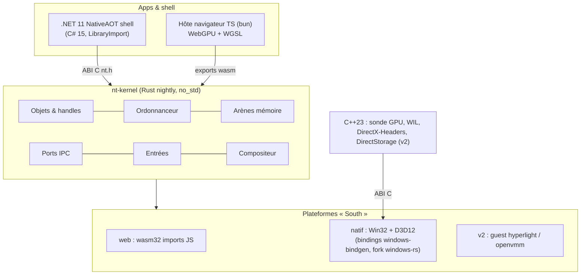

# 03 — Design système

## 1. Vue d'ensemble



Modèle repris de litebox (README vendor) : une interface **North** stable (ce que voient shell et apps) et une interface **South** par plateforme. Le noyau ne connaît ni le navigateur ni Windows.

## 2. Noyau `nt-kernel`

Contraintes : `#![no_std]`, aucun `alloc` dans le chemin chaud, capacité fixée à la compilation, état unique dans un `static` encapsulé (cellule `Sync` mono-thread côté wasm, verrou côté natif multi-thread v2).

| Module | Structure | Taille / limite (v1) |
|---|---|---|
| `object` | table d'objets `[Slot; N]`, handle `u32` = index 20 bits + génération 12 bits (détecte l'usage après fermeture) | N = 65 536 |
| `sched` | 32 files de priorité + bitmap `u32`, tâches coopératives (fonctions d'étape), quantum en ticks | 4 096 tâches |
| `mem` | arènes de pages fixes 64 KiB, allocateur bump par frame remis à zéro | budget E5 |
| `ipc` | ports à anneau de messages de 64 octets, pas de copie au-delà | 1 024 ports |
| `input` | file circulaire d'événements normalisés (pointeur, clavier, molette, tactile) | 1 024 événements |
| `comp` | surfaces : rect f32, rayon, couleur, matériau, z ; arbre parent/enfant ; liste de régions modifiées | 16 384 surfaces |

Sortie par frame : **flux d'instances** contigu (`Instance` = 32 octets, `#[repr(C)]`) + plage modifiée `[first, last)` → l'hôte ne téléverse que la plage modifiée. Si rien n'a changé : `tick()` renvoie 0 → pas de frame (P7).

## 3. ABI C (`nt.h`, unique)

```c
uint32_t nt_boot(uint32_t width, uint32_t height, uint64_t seed);
uint32_t nt_tick(uint64_t now_us);            // nb d'instances à dessiner, 0 = rien à présenter
const void* nt_instances(void);               // pointeur stable (mémoire wasm ou statique natif)
uint32_t nt_dirty_first(void); uint32_t nt_dirty_last(void);
void     nt_input(uint32_t kind, float x, float y, uint32_t code);
uint32_t nt_window_create(float x, float y, float w, float h, uint32_t flags); // handle
void     nt_window_close(uint32_t handle);
const void* nt_stats(void);                   // compteurs (tick µs, surfaces, allocations=0)
```

Règles : types blittables uniquement (exigence .NET 11 pour `UnmanagedCallersOnly` et recommandation GDK `LibraryImport`), pas de chaînes, pas de callbacks dans le chemin chaud.

## 4. Rendu

Une seule technique sur les deux backends : **quads instanciés** générés en vertex shader à partir de `SV_VertexID`/`SV_InstanceID` (aucun vertex buffer), coins arrondis et ombres en **SDF** dans le pixel shader, un seul draw pour toute la scène.

### 4.1 Natif Direct3D 12

| Élément | Choix | Source |
|---|---|---|
| Fenêtre / boucle | `windows-window::run_with` (renvoie `false` au repos → `GetMessageW`, zéro CPU) | windows-rs `crates/libs/window/src/window.rs` |
| Swapchain | flip-discard, 3 buffers, 3840x2160, `DXGI_SWAP_CHAIN_FLAG_ALLOW_TEARING` + `FRAME_LATENCY_WAITABLE_OBJECT`, `SetMaximumFrameLatency(1)` | constantes dans `windows/src/Windows/Win32/dxgi/mod.rs` |
| Présentation | `Present(0, DXGI_PRESENT_ALLOW_TEARING)` si `CheckFeatureSupport(DXGI_FEATURE_PRESENT_ALLOW_TEARING)` | idem |
| GPU | `IDXGIFactory6::EnumAdapterByGpuPreference(HIGH_PERFORMANCE)` | idem |
| Agility SDK | export `D3D12SDKVersion` (+ chemin) depuis l'exe ; version 1.620.2 | Learn « D3D12SDKVersion symbol » |
| Ressources | buffer d'instances dans un tas UPLOAD mappé en permanence (anneau ×3) ; root signature = 1 SRV racine + constantes racine | sample `direct3d12` windows-rs (adapté) |
| Shaders | HLSL 202x → DXIL par DXC au build (`-HV 202x`, SM 6.6) ; blob embarqué dans l'exe | DXC ReleaseNotes |
| Synchronisation | 1 fence, valeur par frame en vol, pas d'attente CPU sauf sur le waitable | sample `direct3d12` |
| Mesure | `ID3D12QueryHeap` timestamps début/fin de frame | Learn D3D12 |

Écran 1440p : swapchain 4K avec mise à l'échelle DXGI (`DXGI_SCALING_STRETCH`) — rendu 4K réel, affichage réduit.

### 4.2 Navigateur WebGPU

| Élément | Choix |
|---|---|
| Adaptateur | `requestAdapter({ powerPreference: "high-performance" })`, journaliser `adapter.info` et `adapter.features` |
| Canvas | `width/height` = 3840x2160 (backing store), taille CSS = fenêtre ; format = `navigator.gpu.getPreferredCanvasFormat()` |
| Données | `GPUBuffer` storage ; `queue.writeBuffer` depuis une vue `Uint8Array` sur la mémoire wasm, plage modifiée seulement |
| Constantes | **immediates** si exposées (livrées Edge 150 ; nom d'API `setImmediates` encore discuté par le WG gpuweb → détection à l'exécution), sinon petit uniform buffer |
| Contexte | `navigator.gpu` n'existe qu'en contexte sécurisé (IDL `SecureContext`) → servir en `localhost` ou HTTPS ; vérifié en phase 0 |
| Boucle | `requestAnimationFrame` ; si `nt_tick` = 0 → aucune soumission |
| Mesure | `timestamp-query` si exposée ; sinon `performance.now()` + `onSubmittedWorkDone` |
| Zéro allocation | objets JS créés au boot, vues réutilisées, aucune closure par frame |

### 4.3 Parité

Les deux shaders (HLSL, WGSL) implémentent la même fonction SDF ; une scène de référence fixe (seed) est rendue par les deux backends et comparée (écart max par pixel ≤ 2/255).

## 5. Shell .NET 11

- Exécutable unique NativeAOT : `nt-kernel` + hôte D3D12 compilés en `staticlib` Rust, liés via `<DirectPInvoke Include="nt" />` + `<NativeLibrary Include="nt.lib" />` (Learn « Native code interop with Native AOT »).
- Le C# n'appelle **jamais** D3D12 directement (Learn : C++ seul langage supporté pour D3D12) ; il appelle l'ABI `nt.h`.
- C# 15 : unions et hiérarchies fermées pour les messages du shell ; `runtime-async=on`.
- Win32 annexe (dialogues, registre) via CsWin32 0.3.371 (générateur de P/Invoke).
- Bibliothèques partagées multi-cibles `net10.0;net11.0`.

## 6. Composants C++23

- `nt-gpu-probe` : `import std;`, WIL (RAII COM), DirectX-Headers (Agility 1.620.2) ; produit un JSON des capacités (SM max, work graphs, DXR, mesh shaders, VRS, tearing) → alimente `facts.json` et décide des chemins de rendu optionnels.
- v2 : streaming d'assets DirectStorage 1.3.0.

## 7. Outillage bun

- `Bun.serve({ routes: { "/": index.html } })` : bundling intégré du TS, sert `nt_kernel.wasm` en route statique.
- `bun build --compile` pour les outils (msdex, facts) ; `bun compile` (AOT, expérimental upstream) quand publié.
- `bun test` (hôte TS + tests d'ABI), `bun check -b`, `bun fmt`.

## 8. Design system visuel « nt »

Noms propres au projet (pas de terminologie de marque MS).

| Jeton | Valeur v1 |
|---|---|
| Typographie UI | **Selawik** (OFL-1.1) ; mono : **Cascadia Code** (OFL-1.1) |
| Icônes | Fluent System Icons (MIT), rendues en atlas SDF |
| Rayons | 4 px (contrôles), 8 px (fenêtres), 12 px (menus) — rendus en SDF |
| Élévation | 3 niveaux d'ombre SDF (flou analytique, pas de passe de blur) |
| Matériaux | `voile` (teinte du fond d'écran précalculée une fois, coût ~0/frame) ; `givre` (flou live au 1/4 de résolution, budget ≤ 0,5 ms GPU à 4K, désactivable) |
| Couleurs | thème clair/sombre + 1 accent, contraste ≥ 4,5:1 (texte) |
| Mouvement | durées 83/167/250 ms, courbes cubiques ; aucune animation ⇒ aucune frame |

## 9. Sécurité et robustesse

- Handles générationnels (pas d'usage après fermeture), aucune entrée externe ne contrôle une taille d'allocation.
- `unsafe` limité à `abi.rs`, `platform/*` ; miri en CI sur `object`, `sched`, `ipc`.
- Binaires Windows : CFG, CET, `/DYNAMICBASE`, CRT statique.
- v2 : apps tierces en guests hyperlight (micro-VM, sans accès hôte par défaut) ou conteneurs mxc.
